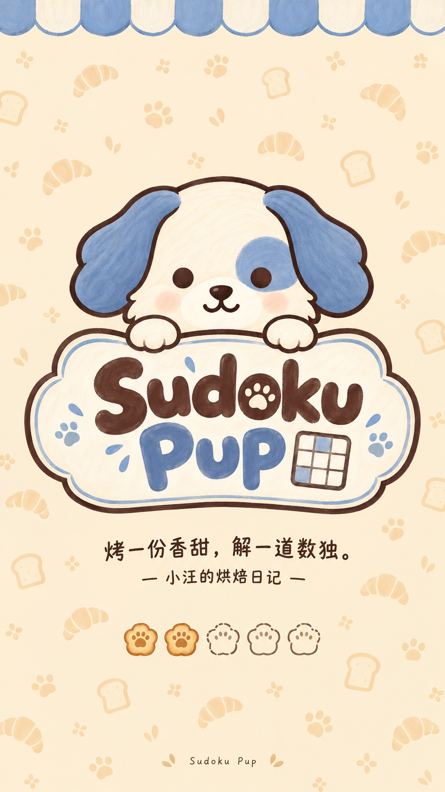

- A1 风格定位与确认基准
	- B1 游戏名称：Sudoku Pup，中文名《数独小汪》。美术主题：小狗面包房。视觉方向：奶油白与雾灰蓝的温暖绘本风格，使用简洁的二维造型与克制的手绘笔触，适配休闲解谜游戏。

	- B2 用户于 2026-10-27 确认的视觉基准为 [小狗正面头像](assets/Sprite/hamster_idle_04__sharedassets2.assets__6.png)。后续制作必须实际查看该图片，并以它作为图像参考；文字描述不能代替参考图。替换对应关系见 [manifest.json](manifest.json)。

	- B3 已确认的是这一张正面头像的造型、配色与画法。完整身体、侧背面、服装、其他表情、背景和 UI 尚无已确认成品，不把这些扩展写成已定稿设计。

	- B4 Logo 页整体样式图：[Panel_Logo_Style_1080x1920.png](assets/UI/Logo/Panel_Logo_Style_1080x1920.png)，尺寸1080×1920，放在对应页面的素材目录内，供制作时直接查看。此图是用户确认的整体视觉参考，不作为单张运行贴图替换，也不代表后续动画和局部修正的最新运行截图。

		

- A2 小狗造型
	- B1 采用正面、居中的单个小狗头像。头部饱满，脸型为柔和的圆角方形，下巴圆润；脸颊两侧保留少量简化毛簇，避免细碎毛发。

	- B2 两只雾灰蓝垂耳从头顶两侧向外、向下展开，耳尖圆钝。垂耳与脸颊共同构成小狗识别轮廓，不沿用原仓鼠顶部的两只直立圆耳和底部横向鼓出的轮廓。

	- B3 主脸为浅奶油白，画面右侧眼睛周围有一块雾灰蓝色眼斑。后续同视角素材保持眼斑在画面右侧，不随意镜像；其他视角需先确认角色自身左右关系。

	- B4 双眼为简洁的深色圆点，鼻子为小而圆钝的深色犬鼻，口鼻区为浅奶油色。嘴部保持轻微微笑，两侧带淡桃色腮红；不画仓鼠胡须。

	- B5 基础头像不添加身体、脖子、爪子、衣服、项圈、厨师帽或面包道具。后续需要这些元素时单独制作变体，不改动基础款来混入新设计。

- A3 配色关系
	- B1 主色：浅奶油白，用于脸部和口鼻区。保留温暖感，避免变成高亮纯白或偏黄橙的大面积毛色。

	- B2 识别色：低饱和雾灰蓝，用于两只垂耳和单侧眼斑。耳朵与眼斑属于同一色系，避免分别变成紫色、青色或高饱和亮蓝。

	- B3 结构色：暖深棕与近深炭色，用于外描边、眼睛、鼻子和嘴巴。深色结构保证缩小后仍可辨认，不使用强烈纯黑粗边。

	- B4 点缀色：淡桃色腮红，面积小、对比轻，不抢过眼睛、鼻子和耳朵。

	- B5 颜色以确认图片中的视觉关系为准。当前不把带笔触图片中的任意单个采样像素定义为唯一标准色；制作不同尺寸时保持明暗、冷暖和饱和度关系，不自由更换整套配色。

- A4 线条、笔触与明暗
	- B1 外描边清楚、连续、圆润，带轻微手绘起伏。线宽观感参照确认图片，不复制原仓鼠外描边，也不增加厚重的双层边框。

	- B2 色块内部保留轻微水粉或干刷质感，形成绘本插画观感。笔触服从大色块，不使用密集纸纹、噪点和逐根毛发。

	- B3 以平面色块为主，只保留轻微的局部明暗变化。避免写实皮毛、塑料高光、立体玩具渲染、金属质感、强烈渐变和戏剧化打光。

	- B4 纹理和深浅变化限定在角色内部；透明区不添加纸张底色、外发光、地面或投影。

- A5 尺寸、位置与文件交付
	- B1 当前这张替换图的画布必须为 509 × 439 像素，PNG、RGBA、真实透明背景。不得将生成工具的更大输出直接作为这一张的最终交付。

	- B2 保持角色居中、完整可见和接近原素材的占用尺度，保留少量透明边距。允许小狗轮廓与原仓鼠不同，不再要求透明蒙版、外描边或外形逐像素一致。

	- B3 当前确认文件的非零透明度边界为左 19、上 5、右 501、下 430 像素，右与下为不包含端点的边界；此值记录该文件实际内容，不作为所有表情或其他素材的通用边界锁。

	- B4 后续其他替换素材分别读取其对应原文件的像素尺寸、透明区、切片和用途，不把全部素材强制输出为 509 × 439。尺寸归一化保持等比，不拉伸角色。

	- B5 新套素材保存在本目录的 assets 下，沿用对应原文件名建立映射。原始参考素材保持不变；制作新方案时另存版本，不覆盖已确认基准。

- A6 后续素材的一致性与检查
	- B1 同一小狗的表情和动作变体保持头脸比例、垂耳结构、眼斑位置、配色和线条体系一致，仅改变必要的表情与动作。

	- B2 后续面包房道具和 UI 可沿用圆润造型、低饱和配色、清楚深色边缘及克制绘本笔触，但具体图案、布局和功能色仍需结合页面制作，不把头像配色机械应用到全部棋盘区域。

	- B3 每张素材检查实际像素尺寸、透明背景、完整边缘和居中位置；按游戏内实际尺寸检查眼睛、鼻子、嘴巴和轮廓能否辨认，避免纹理缩小后变脏。

	- B4 接入棋盘后检查角色与区域颜色的区分度，保留区域颜色与辅助纹样的可辨识性。成品图片已确认不等于已完成 Unity 接入、Play Mode 或真机验证。

- A7 可复用的生成描述
	- B1 使用本目录已确认的小狗头像作为图像参考，制作温暖绘本风格的二维小狗头像；正面居中，饱满圆角方脸，左右两只向下垂落的圆钝耳朵，少量简化脸颊毛簇；浅奶油白脸部、雾灰蓝耳朵及画面右侧单眼眼斑，深暖色圆眼睛、小犬鼻和轻微微笑，淡桃色腮红；清楚圆润的手绘外描边，色块内部仅有克制的水粉干刷笔触，缩小后仍清晰可辨；单个头像、完整可见、真实透明背景。当前对应头像最终画布为 509 × 439 像素。

	- B2 排除项：仓鼠直立圆耳、仓鼠胡须、橙棕色耳朵、写实皮毛、密集纸纹、三维塑料质感、额外身体与服装、背景色块、投影、文字、水印。其他资产使用时调整主体与尺寸描述，继续保留确认图的视觉语言。

- A8 Panel_Logo 首批拆分素材
	- B1 用户已确认 [1080×1920 启动页整体方案](previews/Panel_Logo_overall_v01_1080x1920.png)。本页招牌采用上下两行 Sudoku／Pup，包含小型数独格标志、蓝白遮阳篷、浅色烘焙与爪印纹样和五枚饼干加载标记；这些页面元素以该整体图为基准。

	- B2 首批 13 张替换图片位于 assets/UI/Logo/，详细对应关系、实际像素尺寸及来源见 [页面素材清单](assets/UI/Logo/manifest.json)。名称以当前正式目录为准，已采用 Img_Common_Logo、Img_Logo_HamsterBody 等现有名称；保留 Hamster 等文件名是为了对应引用，图片内容为小狗。

	- B3 完整 Logo、角色可见部分、标题、爪子和加载图标主要从确认稿提取。干净背景、空招牌和闭眼图层通过内置 image_gen 补全；工作底图保存在 previews/Logo_Slicing/。背景不包含文案、Logo 和加载图标，运行文案继续使用既有 TMP 与本地化体系。

	- B4 文件名、像素尺寸、RGBA 和透明区域已做离线检查，另有 [素材总览](previews/Logo_Slicing/contact_sheet_v01.png) 和 [分层拼合预览](previews/Logo_Slicing/page_layers_reassembled_1080x1920.png)。这两类检查不能替代 Unity 运行验证。

	- B5 旧动画按单行招牌设计，不能只换图片就视为整体效果一致。两行招牌的显示尺寸与中心、眼睛对齐、前景爪子遮挡、字母 o 内奶油色爪印的盖章位置、背景顶部裁切，以及动画切换完整 Logo 的衔接，均需在接入阶段核对。离线位置参考保存在 previews/Logo_Slicing/layout_reference.json；当前图片已安装到正式目录 new，旧图归档到 old；正式场景布局和配置尚未调整。

- A9 标题中心爪印动画图层
	- B1 按用户要求，将 Sudoku 中字母 o 内的奶油色爪印独立为 assets/UI/Logo/Img_Logo_Cross.png，保持正式文件的 88×89 像素。它取代此前误选的侧边蓝色装饰爪印；四个趾垫和一个掌垫来自确认稿。

	- B2 Img_Logo_BoardFront.png 中字母 o 的底层已补成完整深棕色字面，爪印隐藏、缩放和位移时不会露出原来的透明镂空；完整静态 Logo 保留最终爪印外观。

	- B3 [爪印盖章动画预览](previews/Logo_Slicing/center_paw_stamp_preview.gif) 为离线缩放与轻微回弹演示，不是 Unity 运行截图。对应位置已写入 layout_reference.json，可继续复用现有 Cross 图层动画槽位；正式场景和 SO 尚未调整。

- A10 正式图片替换与归档
	- B1 2026-10-27 按用户要求将13张新素材安装至 Assets/Res_Runtime/UI/Logo/new/，旧图片归档至同级 old/。new 中图片继承原有 .meta 与 GUID，old 中图片使用独立 GUID，原有场景、SO 和其他页面的序列化引用继续指向新版。

	- B2 LogoSetupEM、HomeSetupEM 中明确的图片加载路径已更新为 new，LogoSetupEM 的素材扫描范围也限定为 new，避免把 old 中归档图片再次批量导入或修改。替换未改动正式场景、动画逻辑或 SO 布局。

	- B3 图片、尺寸、GUID 和引用关系已做文件层检查；新招牌布局、实际导入结果与动画衔接尚未完成 Unity Play Mode 验证，不能将图片安装视为完整页面验收。

- A11 Logo 动画接入与修复
	- B1 按新图层实际透明边距校准角色、眼睛、招牌、前爪和字母 o 内爪印的显示尺寸及位置；校准数据保存在正式 LogoConfig.asset 和 Scene_Main.unity。原始 PNG 像素尺寸与 GUID 保持不变。

	- B2 HamsterMask 是不显示的白色矩形揭示遮罩，不能再换成小狗轮廓形状，否则运动中的脸和耳朵会被固定外形截断。BoardFront 中字母 o 在爪印出现前必须为无爪形残影的完整深棕字面。

	- B3 入场结束保留已经拼合的图层，直接进入整体呼吸与轻微浮动，避免切换完整 Logo 引起比例和位置跳变。关闭入场时仍使用完整 Logo 静态分支，完整图的显示尺寸与中心由 SO 保存。

	- B4 Unity 6000.5.2f1 隔离副本完成视觉 Play Mode 检查、重复初始化和释放、静态分支以及1080×1920、1080×2400、1080×1620渲染。验证中禁用ClientMain以隔离存档和其他服务，没有以此替代完整启动流程或真机验收。修复结果已同步到当前工程，依据见 Logs/LogoAnimationFix/verification.json。

	- B5 字母 o 内的中心爪印在盖章完成后持续独立呼吸缩放，局部比例范围为0.92–1.08，周期约2.24秒；位置不随该局部动画变化。参数使用LogoConfigSO的xIdlePulseAmount和xIdlePulseSpeed，原盖章入场仍保留。

- A12 设置页首批拆分素材
	- B1 用户于2026-10-27确认设置页整体视觉方向并要求切图。[整体样式图](assets/UI/Settings/Panel_Settings_Style_1080x1920.png)保存于页面素材目录，以1080×1920设计坐标归一化；不是运行截图，也不是整页运行贴图。

	- B2 [28张素材清单](assets/UI/Settings/manifest.json)包含背景、无字面板与小狗标题牌、两种按钮底图、开关轨道与独立滑块、选择底图、关闭入口、七类设置图标、底部入口图标、箭头及分隔装饰。背景复用Logo页绘本底图；原设置截图与SettingsPopupLayout配置用于核对功能和组件。无字底图与图标通过内置image_gen重建后分割，不能视为从确认稿无损裁切。

	- B3 中文、版本号、ON／OFF与设置值不烘焙进运行素材，后续使用TMP及既有本地化。纹理、尺寸、透明边界与建议九宫格边距见清单；开关轨道使用普通图片，面板与按钮可使用建议九宫格，仍需Unity实际导入验证。

	- B4 [素材总览](previews/Settings_Slicing/contact_sheet_v01.png)、[分层拼合预览](previews/Settings_Slicing/page_layers_reassembled_1080x1920.png)、[布局参考](previews/Settings_Slicing/layout_reference.json)及[离线检查结果](previews/Settings_Slicing/verification.json)用于接入前查看。原始生成底稿及切图脚本保存在同目录；本批仅保存主题素材，尚未创建或接入设置页Prefab、运行逻辑、SO与Addressables，未进行Unity或真机验收。
